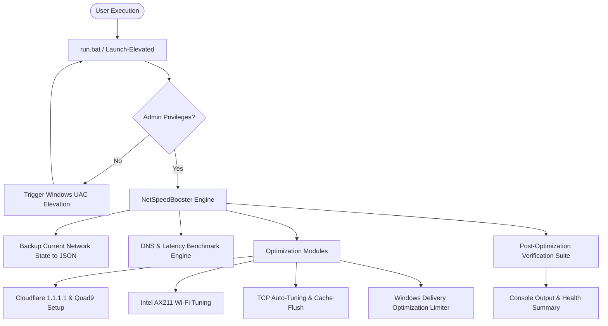

# Technical Architecture — NetSpeedBooster

## 1. System Overview
NetSpeedBooster is a lightweight, modular Windows PowerShell and batch suite designed to diagnose, benchmark, optimize, and restore network configurations on Windows 10/11 systems.



## 2. Tech Stack
- **Language**: PowerShell 5.1 / 7+ and Windows Command Script (`.bat`)
- **APIs**: Windows CIM / WMI (`MSFT_NetAdapterAdvancedProperty`, `MSFT_DNSClientServerAddress`), `NetTCPOptimizer`, `netsh`
- **Integrations**: ChrisTitusTech WinUtil (`christitus.com/win`), GitHub speedtest-cli, GoodbyeDPI
- **Data Persistence**: Local JSON state serialization (`data/backup_state.json`)

## 3. Directory Layout
```
apps/NetSpeedBooster/
├── docs/                      # 10 Vibe Coding Blueprint files
├── data/                      # Backup state and benchmark logs
│   └── backup_state.json
├── src/
│   ├── Benchmark.ps1          # Latency & DNS speed comparison engine
│   ├── Optimizer.ps1          # Core network configuration mutator
│   ├── Rollback.ps1           # Safe 1-click restoration engine
│   └── GitHubTools.ps1        # Hub for launching vetted GitHub tools
├── tests/
│   └── Test-NetSpeedBooster.ps1 # Automated verification test suite
├── optimize.ps1               # Main entry script
├── run.bat                    # Double-click launcher with auto-elevation
└── README.md                  # Complete documentation
```

## 4. Failure Scenario Mitigations
- **Driver Flap Protection**: When changing adapter advanced properties, if the Wi-Fi card disconnects, script waits up to 10 seconds for automatic DHCP re-acquisition.
- **Fail-Safe DNS**: If the primary DNS (1.1.1.1) fails reachability, secondary (1.0.0.1) and tertiary (9.9.9.9) are registered.
- **Instant Rollback**: If the user experiences any regression, executing `Rollback.ps1` immediately reinstates the exact backed-up DNS and adapter parameters.
