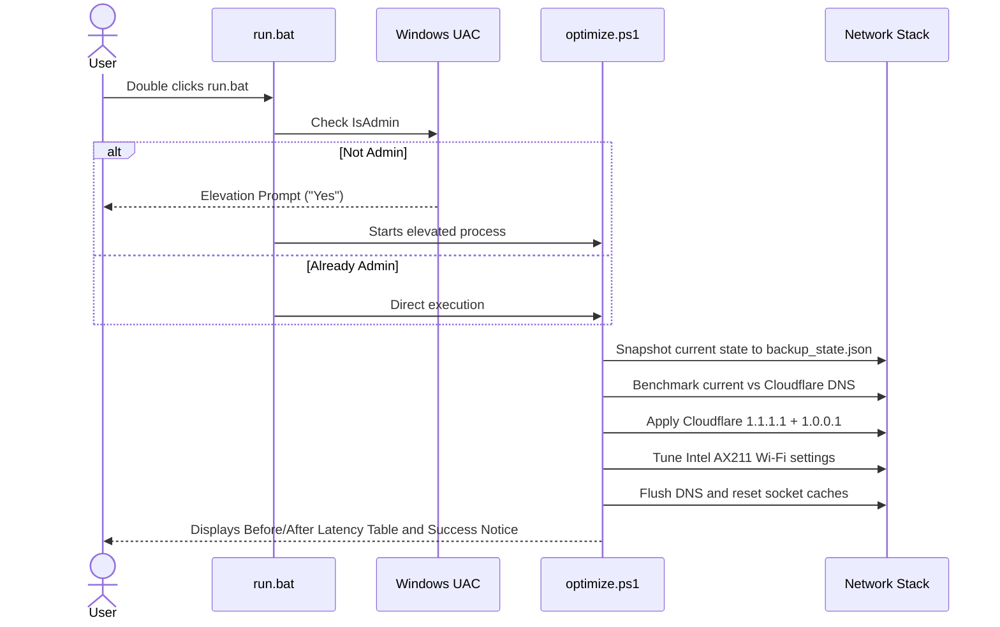

# User Experience Flows — NetSpeedBooster

## 1. Primary Flow: 1-Click Fast Optimization

## 2. Interactive Flow: Menu Options
1. **[1] 1-Click Auto Optimize** (Recommended — Benchmark, Fast DNS, Intel Wi-Fi Tuning, Flush Cache)
2. **[2] DNS Benchmark Only** (Compare current vs Cloudflare, Google, Quad9, OpenDNS)
3. **[3] Launch Chris Titus WinUtil** (Open source GitHub utility for OS-level network debloat)
4. **[4] Launch GoodbyeDPI** (Bypass ISP throttling and DPI)
5. **[5] Rollback to Original Settings** (Restore state from backup)
6. **[6] Run Self-Test Suite**
